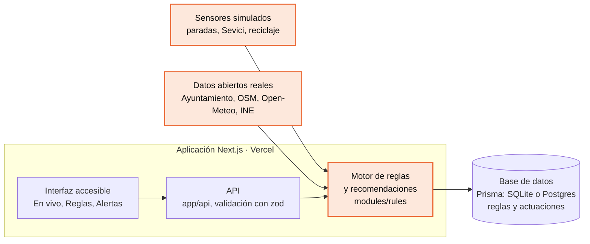

# Sevilla Activa

La navegación del prototipo se organiza en **Inicio** (`/`, con la explicación y fuentes),
**App** (`/app`, interfaz móvil funcional para el vecino) y **Gestión** (`/gestion`, con
actuaciones, sensores, reglas y alertas). Las rutas anteriores siguen disponibles para enlaces.
El agente de planificación está **simulado**, sin modelo de IA conectado. Las actuaciones
se guardan por sesión y minuto y cambian la disponibilidad ficticia del piloto.
El diagrama y los flujos actuales están en [ARQUITECTURA.md](docs/ARQUITECTURA.md).

> Del dato a la acción, en tu barrio: cuando un sensor detecta un problema, la ciudad sabe
> qué alternativa ofrecer y a quién pedir que actúe.

**Demo:** [URL pública] · **Reto:** #48, «Diseña una app que muestre lecturas IoT en tiempo
real (simulado) y dispare reglas automáticas (si X entonces Y)» · **Ámbito:** Innovación e IoT
· Líderes Digitales Universitarios 2026, Universidad de Sevilla

[Pega aquí el bloque de capturas que imprime `npm run screenshots`]

## 1. El problema

Durante un episodio de calor, saber que hay una biblioteca o un centro cívico cerca no
garantiza que esté habilitado como refugio, abierto o con sitio libre. Lo mismo pasa con un
punto de reciclaje lleno o una estación de Sevici vacía: el dato existe, pero no se convierte
en una alternativa utilizable para el vecino ni en una tarea para quien puede resolverlo.

**El dato:** los días con máximas de 40 °C o más en Sevilla pasan de una media de 3,5 al año
en 2000-2009 a 12,3 en 2016-2025 ([Open-Meteo](https://open-meteo.com/), reanálisis ERA5 de
Copernicus, consultado en octubre de 2026). Es la tendencia del entorno de Sevilla, no la
temperatura de cada calle. **Hipótesis a validar:** que en Triana falte cobertura de refugios
disponibles en los momentos de más calor, y cuánto la reduciría el sistema.

**Lo que ya existe.** Sevici publica la disponibilidad de bicicletas, Lipasam ha probado
sensores de llenado [fuente] y el Ayuntamiento ha abierto de forma extraordinaria centros
cívicos como refugios ante el calor [fuente]. Sevilla Activa parte de ahí: conecta la
detección de una incidencia con una respuesta concreta.

## 2. Público destinatario

El usuario principal es el **personal municipal que coordina la respuesta al calor en
Triana**, junto con los responsables de los equipamientos que confirman su disponibilidad.
La **ciudadanía** consulta las alternativas disponibles para resguardarse del calor o
depositar sus residuos, y los **operadores de servicios** (Sevici, Lipasam) reciben sus
tareas. En Triana, el 25,7 % de la población tiene 65 años o más y el 33,6 % de los hogares
son de una sola persona (INE, Atlas de distribución de renta de los hogares, 2023).

## 3. Caso de uso y contexto urbano

**Caso principal: refugios durante un episodio de calor.** Son las 14:30 de un día como el
12 de agosto de 2025 (43,8 °C de máxima, el día más caluroso de ese año en la serie de
Open-Meteo). Una vecina cerca de la calle Pureza, en Triana, busca dónde resguardarse. Los
sensores de las paradas registran más de 40 °C durante 30 minutos y salta la regla. Sevilla
Activa consulta los equipamientos habilitados y comprueba apertura y capacidad antes de
recomendar uno. Si no hay ninguno a la distancia elegida, genera una solicitud para que el
responsable municipal valore activar un espacio o ampliar su horario; la disponibilidad se
publica cuando el responsable la confirma.

**Reciclaje.** A las 20:30, un vecino sale con envases y su punto habitual está lleno. Sevilla
Activa le recomienda otro punto cercano que admite ese material y tiene capacidad, con la
distancia y el motivo; si no hay ninguno, lo dice y genera una incidencia.

**Sevici.** A primera hora, una estación de Triana lleva 15 minutos sin bicicletas. Se genera
una orden de reequilibrado para el operador y se indica una estación cercana con bicicletas.

**Contexto urbano.** El piloto usa ubicaciones reales del distrito de Triana: 68 paradas de
TUSSAM, 31 estaciones de Sevici y 33 puntos de reciclaje, más las bibliotecas y centros
cívicos de toda la ciudad como refugios candidatos (dentro del distrito solo hay dos: la
Biblioteca y el C.C. Las Columnas). Triana tiene unos 46.000 habitantes (INE, 2023). Que un
equipamiento aparezca en el mapa no acredita que esté disponible ni su capacidad.

## 4. Solución tecnológica

Sensores en la calle y reglas «si pasa X, entonces Y» que convierten cada lectura en una
alternativa para el vecino o en una tarea con lugar, hora y responsable.

1. **Mide:** cada sensor envía su lectura (en el piloto, simulada sobre puntos reales).
2. **Decide:** el motor evalúa cada regla con su umbral, duración mínima, franja horaria y
   espera entre avisos.
3. **Actúa:** recomienda una alternativa que cumple las condiciones (abierta, con capacidad,
   compatible, cerca) o, si no la hay, pide al responsable que actúe.



Los bloques en naranja son lo construido para este reto; el resto es una base propia
preparada antes de la prueba (interfaz, API, base de datos y despliegue).

**La pieza propia: el motor de reglas** (`modules/rules/engine.ts`). Recorre el día de cada
sensor en pasos de 5 minutos y dispara una alerta cuando la condición se cumple sin
interrupción durante el tiempo pedido y dentro de la franja horaria, una sola vez por
episodio y con una espera mínima entre avisos. Así, un pico suelto no es una emergencia y la
misma alarma no se repite hasta que nadie la mira. Se descartaron el umbral simple por
lectura (lluvia de avisos) y un modelo de aprendizaje automático (no hay datos para
entrenarlo y no sería explicable). Es una función pura y con tests: en producción recibe la
serie temporal real en lugar del simulador.

**Lógica básica (IF/THEN).**

```text
SI temperatura ≥ 40 °C durante 30 min entre las 12:00 y las 19:00
  ENTONCES buscar refugio habilitado, abierto y con capacidad a ≤ [distancia] m
           SI no hay: solicitar activación o ampliación de horario al responsable
SI llenado del contenedor ≥ 90 %
  ENTONCES recomendar al vecino otro punto con el mismo material y capacidad a ≤ [distancia] m
           y solicitar recogida
SI bicis disponibles = 0 durante 15 min entre las 7:00 y las 23:00
  ENTONCES orden de reequilibrado y estación cercana con al menos 5 bicis
```

**Datos.** Ubicaciones reales del Ayuntamiento de Sevilla y de OpenStreetMap (con los
materiales que admite cada punto de reciclaje), población del INE y temperatura del día real
de Open-Meteo. La curva de temperatura de cada sensor parte del 12 de agosto de 2025 (un test
comprueba que máxima y mínima coinciden con el CSV) más un recargo de calle de 0 a 3 °C,
hipótesis a validar porque ERA5 no recoge la isla de calor.

| Decisión                                     | Por qué                                                                     | Qué se descartó                                           |
| -------------------------------------------- | --------------------------------------------------------------------------- | --------------------------------------------------------- |
| Next.js con rutas de API en un solo proyecto | Un lenguaje, un despliegue y menos puntos de fallo en dos horas y media     | Front y back separados: más tiempo de montaje             |
| Reglas con duración y un aviso por episodio  | Un pico suelto no es una emergencia y la alarma repetida acaba ignorada     | Umbral simple (lluvia de avisos) o aprendizaje automático |
| Simulación anclada a un día real             | La lectura parte de un dato con fuente: 43,8 °C de máxima, 27,4 °C mínima   | Valores aleatorios: no aguantan «¿de dónde sale?»         |
| Recomendar solo lo que cumple condiciones    | El punto más cercano no sirve si está lleno, cerrado o no admite el residuo | Mapa estático con el más cercano (escenario base)         |

## 5. Prototipo

Qué se puede probar hoy en la demo, sin adornos:

| Funcionalidad                                                             | Estado                                                                      |
| ------------------------------------------------------------------------- | --------------------------------------------------------------------------- |
| Motor de reglas (umbral, duración, franja, espera, un aviso por episodio) | Funciona, con tests                                                         |
| Reglas: crear, editar, pausar y borrar                                    | Funciona, guardadas en base de datos y validadas en cliente y servidor      |
| Ubicaciones de paradas, Sevici, reciclaje, bibliotecas y centros cívicos  | Datos reales del Ayuntamiento de Sevilla y OpenStreetMap                    |
| Reloj del día simulado, mapa en vivo y alertas agrupadas por tarea        | Funciona                                                                    |
| Recomendación de refugio y solicitud de activación                        | [Verificar al terminar: estado final]                                       |
| Recomendación de punto de reciclaje compatible                            | [Verificar al terminar: estado final]                                       |
| Lecturas de los sensores                                                  | Simuladas sobre puntos reales; en producción, sensores con LoRaWAN o NB-IoT |
| Habilitación, horarios y capacidad de los refugios; actuaciones           | Simulados; en producción, los confirma el responsable de cada equipamiento  |

**Métrica del piloto.** Porcentaje de solicitudes resueltas con una alternativa válida
(disponible en ese momento, compatible y a [distancia] m como máximo), comparado con un
**escenario base de mapa estático** que recomienda siempre el punto más cercano sin mirar su
estado. Como la simulación es determinista, el resultado se reproduce igual en cada ejecución.
En el día simulado completo: **Sevilla Activa [X] %** frente a **mapa estático [Y] %**
([N] solicitudes).

## 6. Sostenibilidad y escalabilidad

- **Sostenible e inclusiva:** pensada para quien no mira una app del tiempo, como los mayores
  que viven solos (el 33,6 % de los hogares de Triana son unipersonales). Evita
  desplazamientos inútiles a refugios cerrados o puntos llenos. Accesibilidad comprobada:
  navegación completa con teclado, foco visible, cada estado con icono y texto además del
  color, tabla equivalente al mapa y errores enlazados a cada campo.
- **Escala:** el servidor no guarda estado y las alertas se recalculan, así que crece en
  Vercel sin cambios; para más datos, Postgres cambiando solo `DATABASE_URL`. Llevarlo a otro
  distrito u otra ciudad es cambiar el polígono y las capas, y una regla nueva es una fila en
  la base de datos, no código.
- **Viable a largo plazo:** lo sostendría el Ayuntamiento, que ya tiene servicios con datos
  (Sevici, Lipasam, centros cívicos). El coste del software es el alojamiento estándar; el de
  los sensores y su conectividad por calle es una hipótesis a validar. Tecnología estándar y
  mantenida, sin IA ni dependencias exóticas.

## Límites conocidos y próximos pasos

- Las lecturas, la habilitación y la capacidad de los refugios y las actuaciones son
  simuladas; los puntos de reciclaje de OpenStreetMap no son el inventario oficial de Lipasam.
- La temperatura de referencia es un solo punto para toda Sevilla: la diferencia entre calles
  es el recargo simulado.
- El supuesto más frágil: que falte cobertura de refugios en Triana en las horas de más calor.

1. Validar con el distrito qué equipamientos pueden ser refugio, con su horario y aforo.
2. Conectar Sevici en tiempo real (API pública de CityBikes) y los sensores de llenado.
3. Un asistente de IA acotado que redacte la solicitud de activación al responsable.

## Cómo ejecutarlo

Requisitos: Node.js 20.9 a 24.

```bash
npm ci
npm run dev
```

Queda en <http://localhost:3000>, con las reglas de ejemplo cargadas: no hace falta ninguna
clave. `npm test` pasa los tests y `npm run dev:offline` arranca sin internet. Documentación
técnica (motor, API, datos, accesibilidad) en [docs/TECNICO.md](docs/TECNICO.md) y despliegue
en [docs/DEPLOY.md](docs/DEPLOY.md).

**Qué es de hoy y qué no.** La base (Next.js, componentes de interfaz, manejo de errores,
mapa, despliegue) es una plantilla propia preparada antes de la prueba. Durante la prueba se
ha construido el motor de reglas, el simulador de temperatura anclado al día real, las
recomendaciones, la métrica, las pantallas En vivo, Reglas y Alertas, y toda la documentación
de entrega.

## Fuentes

- Ayuntamiento de Sevilla, Centro de Datos Urbanos (ide.SEVILLA):
  <https://cda-idesevilla.opendata.arcgis.com/> — paradas de TUSSAM, estaciones de Sevici,
  bibliotecas, centros cívicos y distritos (octubre de 2026).
- © Colaboradores de OpenStreetMap, licencia ODbL: <https://www.openstreetmap.org/copyright>
  — puntos de reciclaje y materiales que admiten (octubre de 2026).
- INE, Atlas de distribución de renta de los hogares: <https://www.ine.es/> — población,
  mayores de 65 años y hogares unipersonales de Triana (2023). Elaboración propia con datos
  extraídos del sitio web del INE.
- Weather data by Open-Meteo.com: <https://open-meteo.com/> — reanálisis ERA5 y ERA5-Land de
  Copernicus, temperatura diaria desde 2000 (CC BY 4.0).
