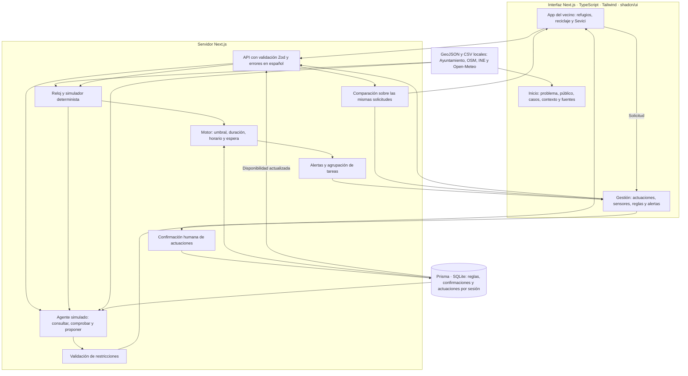
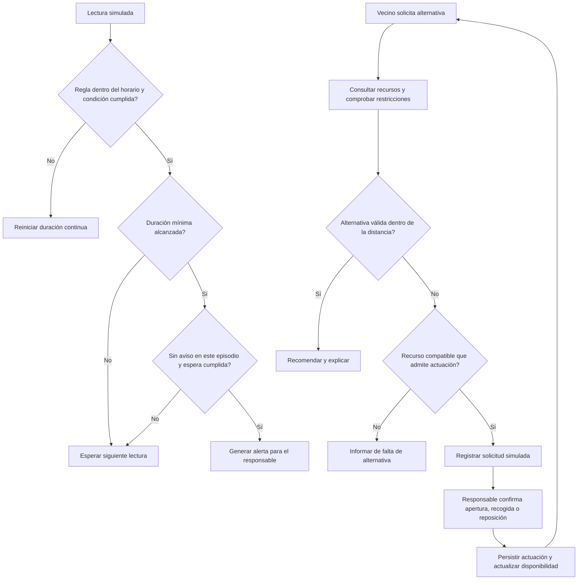

# Arquitectura de Sevilla Activa

El piloto usa ubicaciones reales y lecturas, habilitación, horarios, plazas y actuaciones
simulados. El agente es una simulación determinista con herramientas limitadas; no hay un
modelo de IA conectado. Las confirmaciones solo cambian esta demo.

## Flujo de datos

1. Los archivos locales aportan ubicación y material documentado. El histórico climático
   aporta máximas y mínimas; la curva horaria y el recargo de calle son hipótesis simuladas.
2. El reloj fija el minuto. El simulador produce lecturas reproducibles; las actuaciones de
   la sesión modifican la disponibilidad del piloto desde su minuto de confirmación.
3. El motor evalúa cada regla y genera alertas. La planificación de la app se solicita cuando
   el vecino busca una alternativa; las alertas no ejecutan actuaciones físicas.
4. El agente simulado consulta recursos próximos y comprueba apertura y plazas de refugios,
   material y llenado del reciclaje o bicicletas disponibles. Las distancias son en línea recta.
5. Si encuentra una opción válida, explica su propuesta. Si no, prepara una solicitud cuando
   hay un recurso compatible; si tampoco lo hay, informa sin inventar una alternativa.
6. El responsable confirma una actuación. SQLite conserva sesión, recurso, operación y minuto.
   Una nueva consulta refleja apertura, vaciado o reposición. Una sesión nueva parte del escenario
   base; rebobinar excluye actuaciones posteriores.
7. La métrica compara el mismo conjunto de solicitudes, minuto y radio. Cuenta las que tienen
   alternativa válida usando la opción más cercana sin disponibilidad frente a comprobarla.
   Es un resultado de simulación, no un incremento real de reciclaje ni de protección sanitaria.

## Lógica principal

## Límites del piloto

El rol de gestión es demostrativo, sin autenticación de producción. La habilitación de todos
los equipamientos como candidatos es ficticia. En producción se necesitan acuerdos de datos,
verificación de accesibilidad y protocolos, permisos de gestión y un modelo de IA validado
si se sustituye el planificador simulado. No se usan datos de relojes ni constantes médicas.

Verificación: `npm test`, `npm run typecheck`, `npm run build` y
`npx tsx scripts/verify-pilot.ts` (requiere Chrome o Edge instalado y servidor arrancado).
